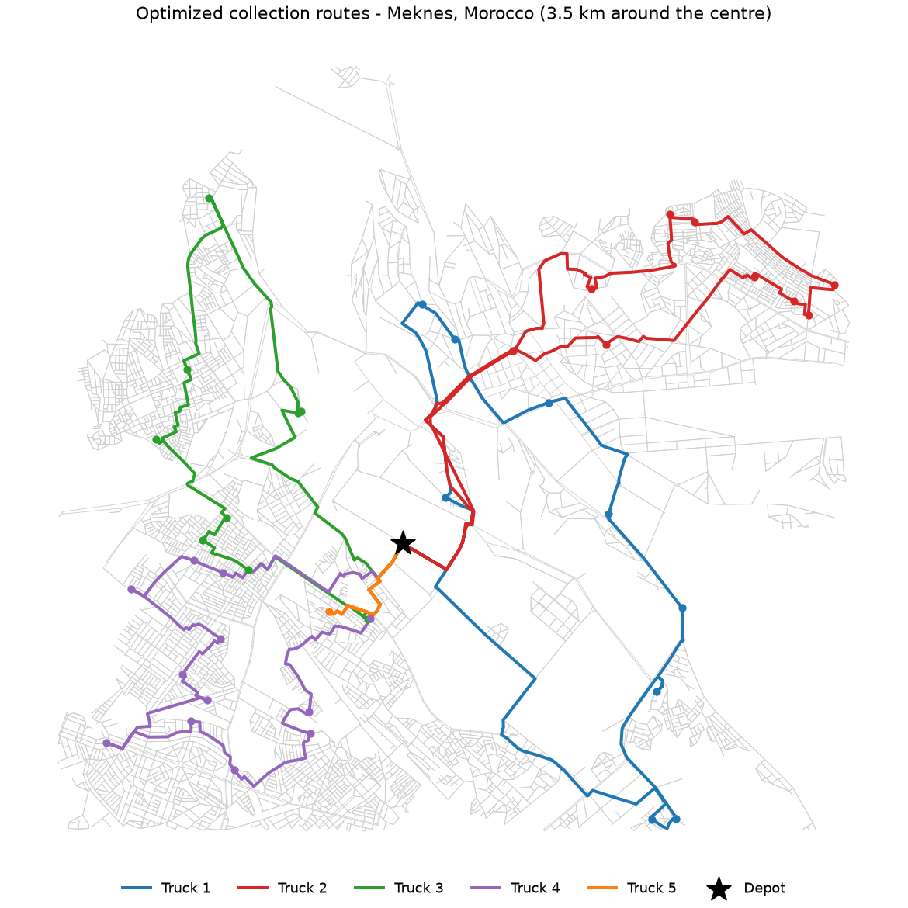

# Waste Collection Route Optimizer

**Predict, then optimize.** Forecast how much waste each collection point will produce tomorrow, then compute the shortest truck routes that collect all of it within vehicle capacity, on the real street network of a Moroccan city.



## The problem

Municipal waste collection is a textbook operations research problem: the **Capacitated Vehicle Routing Problem (CVRP)**. A fleet of trucks with limited capacity leaves a depot, must visit every collection point, and returns. The goal is to minimise the total distance driven.

It is also a real problem in Moroccan cities, where collection rounds are often planned by habit. Shorter routes mean less fuel, lower emissions and fewer missed pickups. And because volumes change from day to day, a good plan needs a forecast before it needs an optimizer.

## How it works

| Step | What happens | Tools |
|---|---|---|
| 1. Road network | Downloads the drivable street network around the city centre from OpenStreetMap (with fallback servers) and keeps its largest strongly connected component, so one-way streets are respected. | OSMnx, NetworkX |
| 2. Distances | Selects a depot and collection points, then computes real road distances with Dijkstra. The matrix is asymmetric because of one-way streets. | NetworkX |
| 3. Forecasting | Simulates 8 weeks of daily waste volumes per point, backtests Holt-Winters exponential smoothing against a seasonal-naive baseline, then forecasts tomorrow with a safety buffer. | statsmodels |
| 4. Optimization | Solves the CVRP with guided local search, minimising total distance under truck capacity. | Google OR-Tools |
| 5. Benchmark | Compares the optimized plan with a nearest-neighbour heuristic and reports the distance reduction. | |
| 6. Outputs | Interactive map, static map, route table and results report. | Folium, Matplotlib |

## Results

Running the pipeline writes the full report to [`results/RESULTS.md`](results/RESULTS.md): forecast accuracy (MAPE) against the baseline, total distance of the optimized plan against the heuristic, and load and distance per truck. The interactive map is `results/routes_map.html`.

## Run it

```bash
pip install -r requirements.txt

# Real street network of Meknes, 3.5 km around the city centre
python main.py

# A larger area
python main.py --radius 5000

# Offline demo on a synthetic grid city, no download needed
python main.py --synthetic
```

| Option | Default | Meaning |
|---|---|---|
| `--city` | `Meknes, Morocco` | City name used in the report and maps |
| `--center` | `33.8935,-5.5547` | Centre of the downloaded area, as `"lat,lon"` |
| `--radius` | `3500` | Radius of the downloaded area, in metres |
| `--place` | none | Download a whole named area instead of a radius (slower) |
| `--points` | `40` | Number of collection points |
| `--vehicles` | `5` | Available trucks, raised automatically if capacity requires it |
| `--capacity` | `2000` | Truck capacity in kg |
| `--buffer` | `0.10` | Safety margin added to forecast volumes |
| `--depot` | network centre | Depot location as `"lat,lon"` |
| `--time-limit` | `15` | Solver time limit in seconds |

## Assumptions and limits

I want the claims of this project to be exactly as strong as the evidence behind them.

- **Waste volumes are simulated.** Per-point collection data is not public for Moroccan cities. The history follows documented assumptions (a base level per point, more waste after the weekend, slight drift, noise). What transfers to real data is the method: backtest, forecast, then route. Real data plugs into `routing/forecast.py`.
- **Collection points are sampled street intersections**, not actual bin locations.
- **The baseline is a heuristic**, a reasonable stand-in for manual planning. It is not the city's current routes, so the reduction is not a claim about current operations.
- **Scope:** one depot, one daily round, no time windows or driver shifts.

## Next steps

- Time windows for collection hours (CVRPTW)
- Several depots and a heterogeneous fleet
- Planning against an upper forecast quantile instead of a fixed buffer, to control overflow risk
- Real collection data from a municipality or operator

## Project structure

```
main.py                 Pipeline entry point
routing/network.py      Road network, depot and points, distance matrix
routing/forecast.py     Simulated history, backtest, forecast
routing/solver.py       OR-Tools CVRP and nearest-neighbour baseline
routing/visualize.py    Interactive and static maps
```

## Author

**Bachir El Bahlouli**, engineer in Mathematics and Computer Science (FST Mohammedia), with a background in operations research, optimization and time-series forecasting.
